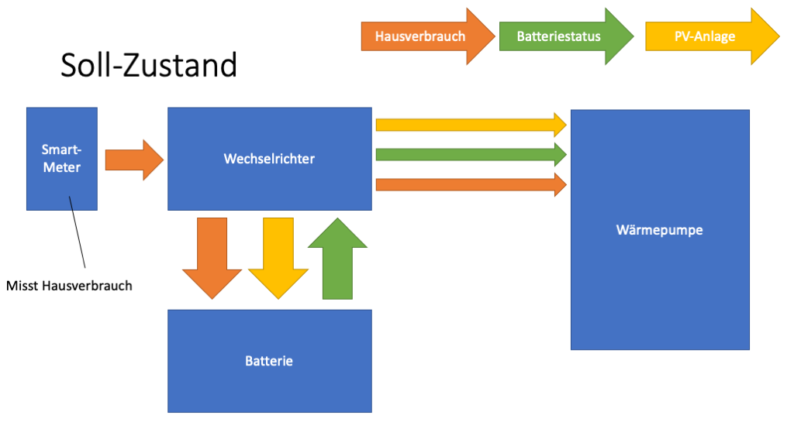
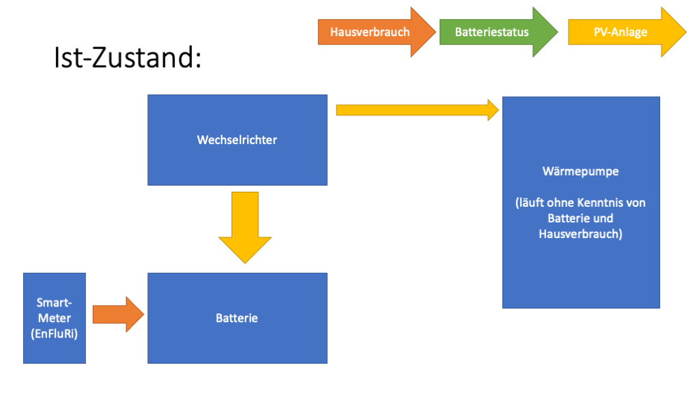
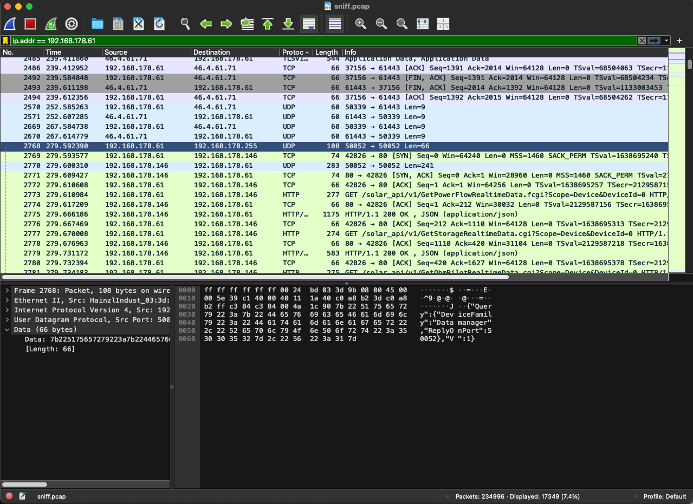
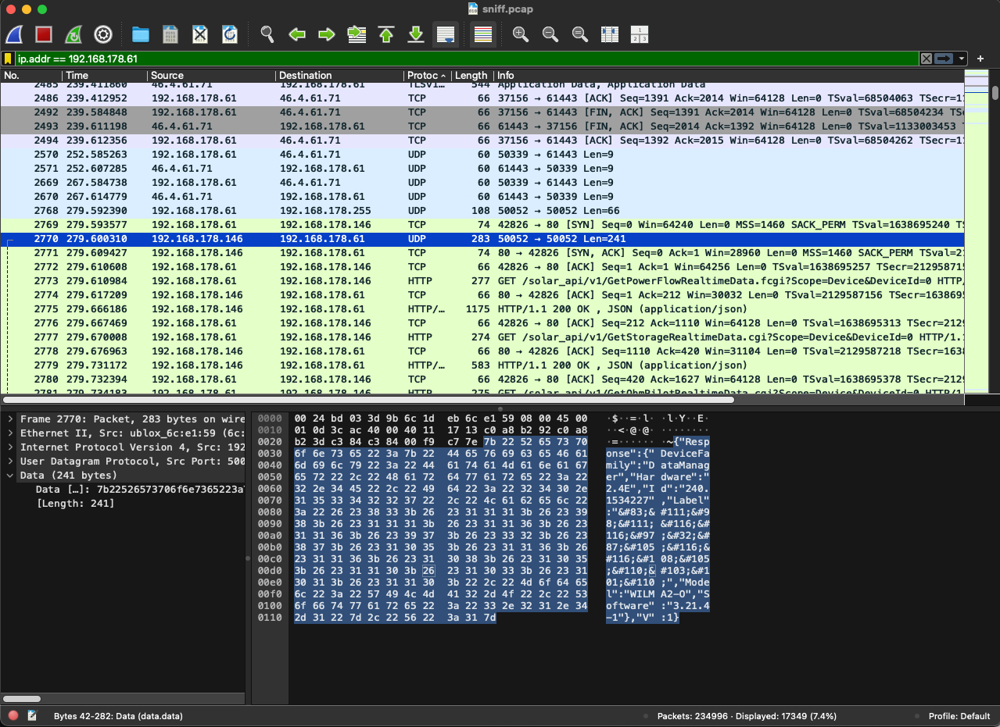
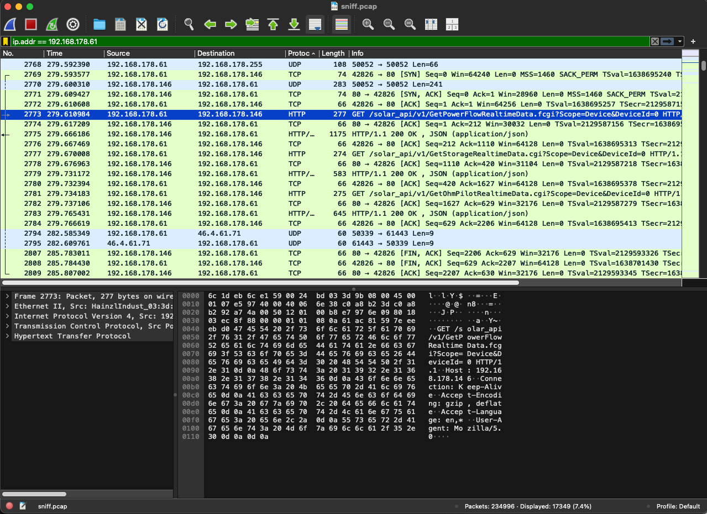
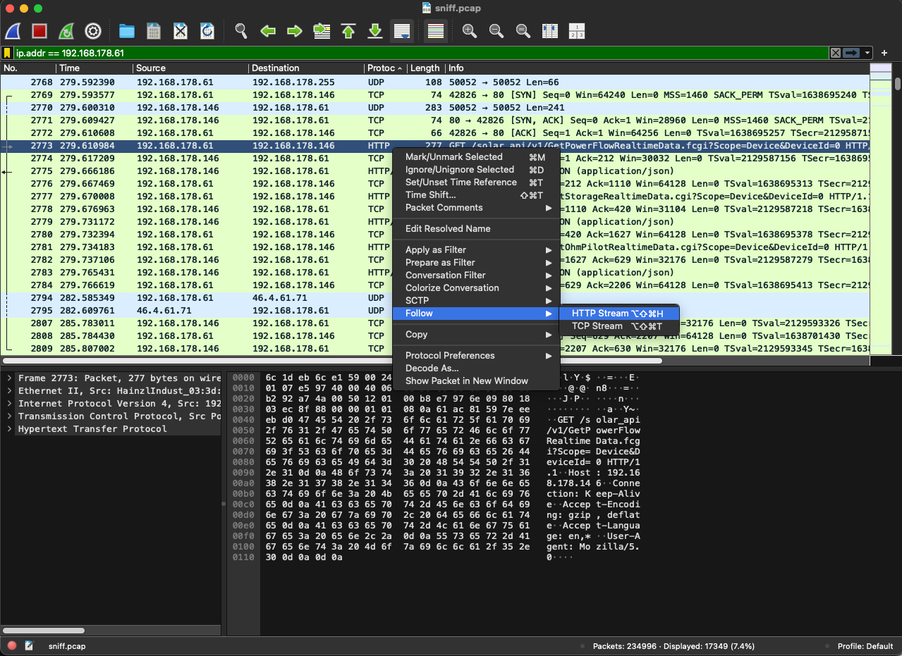
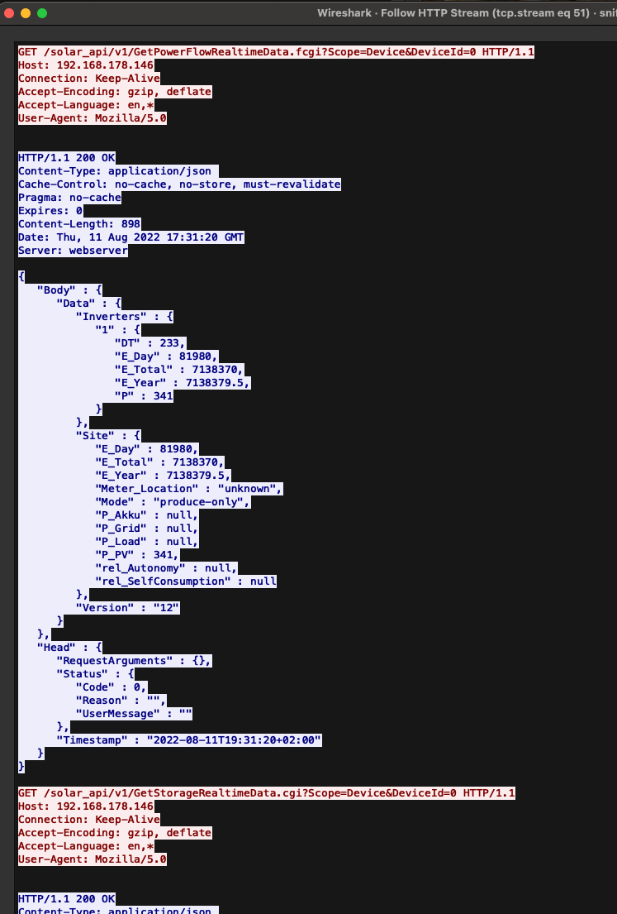

# IDM Wärmepumpe, Fronius und SENEC: Warum das Energiemanagement nicht funktioniert und wie der Hack entstand

Dieses Repository dokumentiert ein sehr konkretes Problem, nach dem vermutlich viele frustriert suchen:

- **IDM Wärmepumpe**
- **Fronius Wechselrichter**
- **SENEC Batterie**
- **kein Hybridwechselrichter**
- **SolarAPI**
- **Wärmepumpe bekommt keine Batterie- und Verbrauchsdaten**

Wenn du eine ähnliche Kombination im Haus hast und dich wunderst, warum die Wärmepumpe zwar einen Fronius findet, aber trotzdem kein sinnvolles Energiemanagement macht, dann bist du hier richtig.

## Kurzfassung

In meinem Haus wurden die falschen Komponenten zusammengebaut:

- Die **Wärmepumpe (WP)** ist von **IDM**
- Der **Wechselrichter** ist von **Fronius**
- Die **Batterie** ist von **SENEC**

Das Problem: Der eingebaute Fronius ist **kein Hybridwechselrichter**. Die SENEC-Batterie ist außerdem **nicht passend integriert**. Dadurch können die Geräte **nicht so miteinander sprechen**, wie die Wärmepumpe es für intelligentes Energiemanagement bräuchte.

Die Wärmepumpe war trotzdem auf **„Fronius“** eingestellt. Sie hat also versucht, mit dem Wechselrichter über die **Fronius SolarAPI** zu reden. Dabei bekommt sie aber nur unvollständige Informationen zurück.

Genau deshalb entstand der Hack: **Ein Hybridwechselrichter wird simuliert**, damit der Wärmepumpe endlich die fehlenden Informationen bereitgestellt werden können.

## Mein Aufbau

- **Wärmepumpe:** `192.168.178.61`
- **Fronius Wechselrichter (non-hybrid):** `192.168.178.146`

Um herauszufinden, was wirklich passiert, habe ich einen Rechner **zwischen Wärmepumpe und Netzwerk** gesetzt und den Traffic über mehrere Stunden mitgeschnitten.

## Soll-Zustand und Ist-Zustand

So hätte das Energiemanagement eigentlich aussehen sollen:



So war es tatsächlich:



Der entscheidende Unterschied ist:

- Im **Soll-Zustand** ist der Wechselrichter die zentrale Stelle für **PV**, **Batterie** und **Hausverbrauch**
- Im **Ist-Zustand** liefert der non-hybrid Fronius diese Hybrid-Informationen **nicht**

## Schritt 1: Die Wärmepumpe sucht ihren Fronius per UDP-Broadcast

Das erste wichtige Ergebnis aus dem Mitschnitt: Die Wärmepumpe sucht ihren Ansprechpartner **nicht manuell**, sondern über einen **UDP-Broadcast** im lokalen Netz.

Auf dem Screenshot sieht man, dass die Wärmepumpe (`192.168.178.61`) an `192.168.178.255:50052` sendet:



Die Bedeutung ist einfach:

- Die Wärmepumpe fragt im Netzwerk: **„Wo ist hier ein Fronius Datamanager?“**
- Der Broadcast dient also dazu, dass die WP **ihren Fronius Ansprechpartner findet**

## Schritt 2: Der Fronius antwortet auf die Suche

Der Fronius-Wechselrichter (`192.168.178.146`) antwortet auf diesen Broadcast mit einer Datamanager-Antwort.



Damit ist klar:

- Die Wärmepumpe und der Wechselrichter **finden sich**
- Das Problem ist **nicht** die Netzwerkerkennung
- Das Problem beginnt **danach**, wenn es um die eigentlichen Daten geht

## Schritt 3: Danach startet die eigentliche Kommunikation per TCP und HTTP

Sobald sich WP und Fronius gefunden haben, öffnet die Wärmepumpe eine normale **TCP-Verbindung auf Port 80** und schickt **HTTP-GET-Anfragen** an die Fronius SolarAPI.

Das sieht man hier:



Als Protokollreferenz dient in diesem Repository die Datei:

- [`SolarAPI_v1.pdf`](SolarAPI_v1.pdf)

Diese Fronius-Dokumentation bestätigt auch den wichtigen Grundsatz:

- **SolarAPI V1 arbeitet über HTTP-GET**

## Schritt 4: HTTP-Stream in Wireshark sichtbar machen

Um die eigentlichen Anfragen lesbar zu machen, kann man in Wireshark dem HTTP-Stream folgen:



Das Ergebnis dieses Schritts ist hier abgelegt:

- [`06_http_stream.txt`](06_http_stream.txt)

Und als Screenshot:



## Die drei immer gleichen SolarAPI-Abfragen der Wärmepumpe

Ich habe auch andere Streams angesehen. Das Ergebnis war immer gleich: Die Wärmepumpe schickt **immer dieselben drei Abfragen**, und zwar in dieser Reihenfolge:

```http
GET /solar_api/v1/GetPowerFlowRealtimeData.fcgi?Scope=Device&DeviceId=0 HTTP/1.1
GET /solar_api/v1/GetStorageRealtimeData.cgi?Scope=Device&DeviceId=0 HTTP/1.1
GET /solar_api/v1/GetOhmPilotRealtimeData.cgi?Scope=Device&DeviceId=0 HTTP/1.1
```

Das ist ein sehr wichtiger Befund für alle, die dieselbe Kombination debuggen:

- Die Wärmepumpe fragt **nicht beliebige Fronius-Endpunkte** ab
- Sie erwartet offenbar **ganz gezielt Daten zu Power Flow, Speicher und OhmPilot**

## Ein echtes Fronius-Gen24-Beispiel als Vorlage

Die Fronius-Dokumentation ist hilfreich, aber für einen echten Hack ist ein **reales Beispiel** noch besser. Deshalb war ich zusätzlich bei einem Bekannten mit einem **Fronius GEN24**, also einem **Hybridwechselrichter**.

Dort habe ich die gleichen API-Endpunkte einfach direkt per Browser aufgerufen und die Antworten gespeichert:

- [`GetPowerFlowRealtimeData.fcgi.json`](GetPowerFlowRealtimeData.fcgi.json)
- [`GetStorageRealtimeData.cgi.json`](GetStorageRealtimeData.cgi.json)
- [`GetOhmPilotRealtimeData.cgi.json`](GetOhmPilotRealtimeData.cgi.json)

Das ist wichtig, weil wir damit nicht nur die Theorie aus `SolarAPI_v1.pdf` haben, sondern auch eine **echte Vorlage aus einem laufenden Hybrid-System**.

### Was man im GEN24-Beispiel sofort sieht

Der Unterschied zum non-hybrid Fronius ist deutlich:

- Der GEN24 meldet bei `GetPowerFlowRealtimeData` **nicht** `produce-only`, sondern:
  - `"Mode" : "bidirectional"`
- Es gibt dort echte Werte für:
  - `P_Grid`
  - `P_Load`
  - `P_Akku`
  - `P_PV`
- Zusätzlich tauchen Hybrid-relevante Felder auf wie:
  - `BatteryStandby`
  - `BackupMode`
  - `SOC`
  - `Battery_Mode`

Mit anderen Worten:

- Der GEN24 liefert genau die Art von Informationen, die bei meinem echten Aufbau fehlen
- Genau diese Struktur brauchen wir später als Vorlage für den simulierten Hybridwechselrichter

### 1. Beispiel: `GetPowerFlowRealtimeData.fcgi.json`

Im echten GEN24-Beispiel sieht man unter anderem:

- `"Mode" : "bidirectional"`
- `"Meter_Location" : "grid"`
- `"P_Akku" : 0.0`
- `"P_Grid" : 696.8`
- `"P_Load" : -696.8`
- `"P_PV" : 0.0`
- `"BatteryStandby" : false`
- `"BackupMode" : false`
- `"Version" : "12"`

Außerdem enthält der Bereich `Inverters` zusätzliche Hybrid-Informationen wie:

- `"Battery_Mode" : "suspended"`
- `"SOC" : 36.0`

Das ist genau der Unterschied zum non-hybrid Fronius:

- Beim echten Hybridwechselrichter gibt es **Batterie- und Verbrauchsdaten**
- Beim non-hybrid Fronius fehlen diese Daten oder sind `null`

### 2. Beispiel: `GetStorageRealtimeData.cgi.json`

Auch die Speicherantwort ist auf dem GEN24 genau das, was man von einem Hybrid-System erwartet.

Dort kommen zum Beispiel:

- `Capacity_Maximum`
- `DesignedCapacity`
- `Current_DC`
- `Voltage_DC`
- `Temperature_Cell`
- `StateOfCharge_Relative`
- `Status_BatteryCell`
- `Details.Manufacturer`
- `Details.Model`

Im konkreten Beispiel ist die Batterie:

- **Hersteller:** `BYD`
- **Modell:** `BYD Battery-Box Premium HV`

Damit haben wir eine sehr brauchbare Vorlage dafür, **wie eine gültige Speicherantwort aussehen muss**, wenn die Wärmepumpe einen Hybridwechselrichter vor sich haben soll.

### 3. Beispiel: `GetOhmPilotRealtimeData.cgi.json`

Der Bekannte hat **keinen OhmPilot**. Die Antwort enthält deshalb:

```json
"Code" : 12,
"Reason" : "OhmPilot '0' does not exist."
```

Das ist in diesem Fall sogar hilfreich:

- Mein Bekannter hat keinen OhmPilot
- Ich habe auch keinen OhmPilot
- Für meinen Anwendungsfall ist diese Antwort also **vollkommen passend**

Wichtig ist nur:

- Auch auf einem echten GEN24 wird dieser Endpunkt sauber beantwortet
- Selbst wenn kein OhmPilot existiert, kommt eine **plausible, gültige Antwort**

## Warum das GEN24-Beispiel für den Hack so wichtig ist

Bis hierhin wussten wir:

- welche drei Endpunkte die Wärmepumpe abfragt
- dass mein echter non-hybrid Fronius dafür nicht die nötigen Daten liefert

Mit dem GEN24-Beispiel wissen wir jetzt zusätzlich:

- **wie** ein echter Hybridwechselrichter auf genau diese drei Abfragen antwortet
- **welche Felder** vorhanden sein müssen
- **welche Struktur** die JSON-Antworten haben
- **welche Antwort auch ohne OhmPilot noch plausibel ist**

Damit haben wir jetzt eine belastbare Vorlage für den nächsten Schritt:

> **Einen Fronius-Hybrid so zu simulieren, dass die IDM-Wärmepumpe genau die Antworten bekommt, die sie erwartet.**

## Was der echte non-hybrid Fronius zurückliefert

Die Antworten erklären, warum das Energiemanagement scheitert.

### 1. `GetPowerFlowRealtimeData.fcgi`

Der Wechselrichter meldet:

- `"Mode" : "produce-only"`
- `"P_Akku" : null`
- `"P_Grid" : null`
- `"P_Load" : null`

Das bedeutet in normalen Worten:

- Der Fronius sagt im Grunde: **„Ich bin nur PV-Erzeuger.“**
- Er liefert **keine brauchbaren Hybrid-Daten**
- Es fehlen genau die Informationen, die für eine Wärmepumpe interessant wären:
  - Hausverbrauch
  - Netzbezug / Einspeisung
  - Batterieleistung
  - sinnvoller Batteriestatus

### 2. `GetStorageRealtimeData.cgi`

Hier kommt vom Fronius:

```json
"Code" : 255,
"Reason" : "GetStorageRealtimeData request is not supported by this device."
```

In Klartext:

- Der Wechselrichter sagt offen, dass **dieser Speicher-Endpunkt auf diesem Gerät nicht unterstützt wird**

### 3. `GetOhmPilotRealtimeData.cgi`

Hier kommt:

```json
"Code" : 12,
"Reason" : "DeviceId '0' does not exist"
```

In Klartext:

- Die Wärmepumpe fragt nach einem Gerät oder Datentyp, den dieser Fronius **gar nicht hat**

## Die eigentliche Schlussfolgerung

Das Grundproblem ist also nicht:

- dass die Wärmepumpe den Fronius nicht findet
- oder dass HTTP nicht funktioniert
- oder dass die SolarAPI gar nicht benutzt wird

Das eigentliche Problem ist:

- Die Wärmepumpe findet erfolgreich einen **Fronius**
- Aber sie findet **keinen Hybridwechselrichter**
- Deshalb bekommt sie **nicht die Daten**, die sie für intelligentes Energiemanagement erwartet

## Warum daraus ein Hack wurde

Wenn die Wärmepumpe einen Fronius erwartet, der Informationen zu

- PV-Leistung
- Batteriestatus
- Batterie-Leistung
- Hausverbrauch
- Netzbezug / Einspeisung

bereitstellt, der echte Wechselrichter aber nur **„produce-only“** liefert, dann bleibt nur ein logischer nächster Schritt:

> **Einen Hybridwechselrichter simulieren, der genau diese fehlenden Informationen bereitstellen kann.**

Genau das ist die Idee hinter dem Hack, der in den nächsten Schritten dokumentiert wird.

## Ziel dieses Repositorys

Dieses Repository soll Menschen helfen, die mit Suchbegriffen wie diesen hier landen:

- **IDM Wärmepumpe Fronius SENEC Problem**
- **Fronius produce-only Wärmepumpe**
- **IDM Wärmepumpe bekommt keine Batteriedaten**
- **Fronius SolarAPI GetPowerFlowRealtimeData GetStorageRealtimeData**
- **Wärmepumpe Hybridwechselrichter simulieren**

Wenn du in genau so einer Situation bist: Du bist nicht verrückt. Die Geräte **reden tatsächlich nicht so miteinander**, wie man es bei einer sauber geplanten Hybrid-Lösung erwarten würde.
